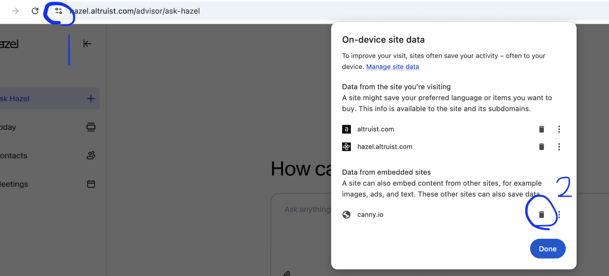
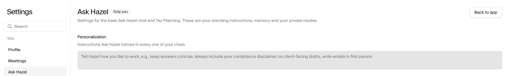
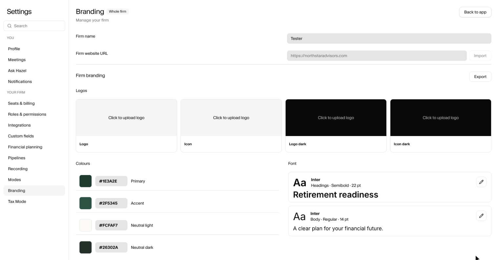

### Ask Hazel FAQ

<AccordionGroup>
  <Accordion title="How do I upload a pdf for Hazel to review?">
    Simply click on the plus icon within the Ask Hazel search bar, type in your prompt, and press enter! Hazel will analyze the file and provide you with a response.
  </Accordion>

  <Accordion title="The 'Ideas' link is not working. I am getting the following message, 'Hazel's feedback is private. Log in to see if you have access.'">
    The Ideas page is how we track feedback, through Canny's feedback portal. If it is not working, try clearing your cookies/data on the Hazel page for the Canny connection. Then try again by refreshing and re-clicking the Ideas button within Hazel.

    
  </Accordion>

  <Accordion title="I tagged a chat to the wrong contact. Can I change the tag?">
    No. A chat can be tagged to only one household or person, and the tag is final once applied, so the client's information doesn't mix into another client's record. To fix a wrong tag, copy anything you need from the chat, delete it, and start a new chat tagged to the correct household or person.
  </Accordion>

  <Accordion title="Can I give Hazel standing instructions, or get reports as Word files in my firm's style?">
    For standing instructions, use **Settings → Ask Hazel → Personalization**. Hazel follows them in your Ask Hazel chats, including Tax Mode and your Modes. To use an instruction only sometimes, put it in a [custom Mode](/guides/modes/custom-modes) instead. Personalization applies only to you, not your whole firm, and holds up to 1,500 characters.

    Formatting works differently. Hazel creates reports as PDFs, and you can't set their font size with an instruction. Reports pick up your firm's colors, fonts, and logo from **Settings → Branding**. To get a Word file, select **Export as Word** on a report Hazel created, including tax plans, and edit it there.

    
  </Accordion>

  <Accordion title="Can I brand the PDFs Hazel generates?">
    Yes. Owners and Firm Admins set your firm's logos, colors, and fonts once in **Settings → Branding**, under **Firm branding**, and Hazel applies them to the PDF and Word reports it creates. The report logo and firm disclaimer for tax plans are set in **Settings → Tax Mode**. For financial plans, layout and the client disclaimer are in [Planning settings](/guides/financial-planning/settings/overview).

    
  </Accordion>

  <Accordion title="Can Hazel read files in Google Drive, SharePoint, or our CRM's document storage?">
    Not for most firms yet. Cloud storage connections are rolling out gradually; if you don't see **Cloud storage** in **Settings → Integrations**, it isn't available for your firm yet. Hazel also can't see documents attached inside your CRM. Upload the files to a household's **Documents** tab, or attach them to a chat, so Hazel can use them.
  </Accordion>

  <Accordion title="Is there a Hazel browser or desktop extension?">
    No. Hazel works in your web browser. The Hazel mobile app for iPhone and Android lets you sign in, see your meetings, and record in-person meetings. There is no browser extension or desktop app. For questions about Altruist's own products, contact Altruist support.
  </Accordion>

  <Accordion title="Can I make changes to my Altruist data within Hazel?">
    No, you cannot edit your Altruist data within Hazel. Hazel has read-only access to your custodial data in Altruist.
  </Accordion>

  <Accordion title="Do my team members have access to view my Altruist data?">
    In chat, no. Chat only relies on individual account data, meaning you have to connect to your Altruist account connected to view any custodial data.

    In meeting agendas, perhaps. Meeting prep and agendas rely on the calendar event owner's Altruist connection, so your Altruist account data could be shared if other Hazel team members in your firm have access to the same meeting via the household participant permission. More on household permissions here.
  </Accordion>
</AccordionGroup>

### Meetings FAQ

<Accordion title="How do I edit speaker labels?">
  

  To edit speaker labels in a Meeting transcript:

  1. Open the Transcript tab in the Meeting you would like to update.
  2. Click on the name of a Speaker label. You will be presented with the option to:
     - Rename Manually
     - Rename as Client
     - Swap Labels
  3. Click Save
</Accordion>

<AccordionGroup>
  <Accordion title="Can Hazel automatically ignore certain meetings, like a daily calendar reminder?">
    Yes. Create or edit a meeting type, turn on **Ignore Meeting Type**, and add phrases from the events' titles under **Match on Phrases**. Any calendar meeting whose title contains one of those phrases gets no notetaker and moves out of your main meetings list. Use **Settings → Meetings** for a personal type, or **Settings → Recording** for a firm-wide one (Owners and Firm Admins). See [Adding meeting types](/guides/meeting-assistant/meeting-types/adding-meeting-types#ignore-meetings-automatically).

    To skip a single meeting, use **Ignore** on that meeting. To stop the notetaker joining any calendar event, turn off **Auto-schedule Notetakers** in **Settings → Meetings**.
  </Accordion>

  <Accordion title="Can I receive the full meeting notes by email instead of the summary?">
    Not today. The post-meeting email contains a short recap and your action items, with a **View meeting notes** link to the full notes in Hazel. There is no setting to send the full notes by email.
  </Accordion>

  <Accordion title="Why does my notetaker's name include '(AI)'? Can I remove it?">
    Hazel adds "(AI)" to the [notetaker name](/guides/settings/meeting-settings) on every platform, including Zoom, Google Meet and Microsoft Teams, and it can't be removed. If your name already includes "(AI)", Hazel doesn't add it again. On Teams, the name also ends with ". Recording". Only firm Owners can change the notetaker name, in **Settings → Recording**.
  </Accordion>
</AccordionGroup>

### Email FAQ

<AccordionGroup>
  <Accordion title="Does Hazel match my writing style? Is there a way to set rules where I have a certain tonality and certain words and language I use?">
    On the follow up emails, you can tweak the prompt and give Hazel instructions and example quotes of things you'd likely say. By instructing Hazel in the prompt, you can set rules for tones to follow.

    For replies to client emails, ask Hazel in chat and include any tone or wording instructions in your request.
  </Accordion>

  <Accordion title="Where did the Inbox go?">
    The Inbox has been retired. Client emails now live on each household's **Emails** tab, and you draft replies by asking Hazel in chat.
  </Accordion>

  <Accordion title="Can Hazel draft replies to client emails automatically?">
    Hazel doesn't draft replies to incoming emails on its own. Ask Hazel in chat to draft a reply. When you write an email in Hazel, you can send it or choose **Save to drafts** to put it in your Gmail or Outlook drafts folder. If you turn on **Auto-save Follow-up Email Drafts** in **Settings → Meetings**, Hazel also saves meeting follow-up emails to your drafts folder for you.
  </Accordion>

  <Accordion title="Can I connect more than one email account?">
    You can connect one Google account and one Microsoft account, in **Settings → Profile** under **Email and Calendar**. Connecting a different account from the same provider replaces the one you had. If you're moving to a new email domain, finish the migration first, then connect the new account. Forwarding one account to the other can create duplicate emails or mismatches with your CRM contacts, so avoid it.
  </Accordion>

  <Accordion title="Which emails does Hazel bring in?">
    Hazel brings in emails from people who match a contact in Hazel and shows them on that contact's household **Emails** tab. Email screening settings are no longer available.
  </Accordion>
</AccordionGroup>

### Altruist Integation FAQ

<AccordionGroup>
  <Accordion title="Can I make changes to my Altruist data within Hazel?">
    No. Hazel has read-only access to your custodial data in Altruist.
  </Accordion>

  <Accordion title="Do my team members have access to view my Altruist data?">
    In chat, no. Chat only relies on individual account data, meaning you have to connect to your Altruist account to view any custodial data.

    In meeting agendas, perhaps. Meeting prep and agendas rely on the calendar event owner's altruist connection, so your Altruist account data could be shared if other Hazel team members in your firm have access to the same meeting via the household participant permission. [More on household permissions here.](/guides/settings/members/roles-and-permissions)
  </Accordion>

  <Accordion title="I connected Hazel to Altruist but it is not populating my Altruist contacts. Why?">
    We can only pull contacts from your CRM at this time, not Altruist.

    The Altruist integration is completely separate from contacts. Meaning if you go into chat today and ask it for custodial data, it would fetch the appropriate Altruist contact and the relevant details.
  </Accordion>
</AccordionGroup>

### Billing FAQ

<AccordionGroup>
  <Accordion title="Do new users get a free trial?">
    Each firm has one free trial period. It’s advised that all users in the firm test Hazel through that free trial. Reach out to [support@hazel.ai](mailto:support@hazel.ai) if you have any questions on your free trial.

    <Info>
      Each firm has one free 14 day trial period.
    </Info>
  </Accordion>

  <Accordion title="What date does Hazel bill my subscription?">
    All users are billed on the 1st of the month in which their subscription is due.

    Monthly users are billed on the 1st of the month, each month they are subscribed.

    Annual users are billed on the 1st of the month after their annual subscription is due.
  </Accordion>

  <Accordion title="How do I update my payment method?">
    Go to **Settings → Seats & billing**, scroll to **Billing**, and select **Manage billing**.

    <Info>
      Only Owners can invite new members and manage roles.
    </Info>
  </Accordion>

  <Accordion title="How will Hazel charges appear on my credit card or bank statement?">
    Hazel charges will appear on your statement as `ALTRUIST HAZEL.AI`.
  </Accordion>

  <Accordion title="Where can I download past invoices and receipts?">
    Go to **Settings → Seats & billing**, scroll to **Billing**, and select **Manage billing** to download past invoices and receipts.

    <Info>
      Only Owners can invite new members and manage roles.
    </Info>
  </Accordion>

  <Accordion title="Can I set up automatic invoices for future charges?">
    Yes. Reach out to [support@hazel.ai](mailto:support@hazel.ai) to enroll in automatic invoices.
  </Accordion>

  <Accordion title="What does Financial Planning cost, and does it include my other subscriptions?">
    A Financial Planning Agent seat includes everything in Platform AI and the Tax Planning Agent for one per-seat price, so you aren't billed separately for them. See current rates on the [pricing page](https://hazel.ai/pricing).

    When you upgrade mid-term, you're charged today for the rest of your current billing period, and your renewal date stays the same. **Settings → Seats & billing** shows the exact amount before you confirm. If you're in a Financial Planning trial, the prorated charge is billed when the trial ends. Annual billing costs 10 percent less than paying monthly for 12 months. See [Billing](/guides/settings/billing).
  </Accordion>

  <Accordion title="Can I add someone who only manages the team or billing?">
    Everyone at your firm is invited as an **Advisor** or an **Owner** and billed per seat. To let someone manage members, billing, branding, meeting types and planning settings without seeing more client data, invite them as an Advisor and give them the **Firm Admin** permission. See [Roles and permissions](/guides/settings/members/roles-and-permissions) and [Managing teams](/guides/settings/members/managing-teams).
  </Accordion>
</AccordionGroup>

### Households and contacts FAQ

<AccordionGroup>
  <Accordion title="Can I merge duplicate households?">
    Yes. In your Households list, select the two households and choose **Merge**. Hazel shows a preview of the people and records that will move, and what will be sent to your CRM, before you confirm. Links to the merged household redirect to the one you kept.
  </Accordion>
</AccordionGroup>

### Security FAQ

<AccordionGroup>
  <Accordion title="Where can I get Hazel's SOC 2 report for vendor due diligence?">
    Go to the [Hazel Trust Center](https://trust.hazel.ai/) and select **Request Access** to view the SOC 2 report, penetration test summary, and other security documents.
  </Accordion>
</AccordionGroup>

### Intelligent Client Profiles FAQ

<AccordionGroup>
  <Accordion title="Where does Hazel actually use the profile?">
    In chat, in meeting prep, in financial planning, and on the household Summary tab. Ask Hazel (including the chat rail on the household page) reads the profile first when a question concerns a client; meeting prep and financial planning start from it. The Summary tab is written from it, sentence by sentence, with citations. It works in both directions: you can also update the profile from chat by telling Hazel what changed and confirming. When Hazel uses a fact you haven't verified, the fact is flagged as unverified rather than presented as settled. Archived records are left out entirely.
  </Accordion>

  <Accordion title="How do I update the profile from chat?">
    Tell Hazel, in plain English: "Update Bob's 401(k) balance to $$612,000," "they opened
a 529 for Maya at Fidelity, $$25,000 to start," or "fix the owner on the term policy, it's Sarah's." Hazel shows you the exact updates planned; confirm, and they're applied as your entries: verified, and visible in each value's History. Nothing changes without your confirmation, and you need edit access to the client, just like on the Data tab.
  </Accordion>

  <Accordion title="How is this different from my CRM?">
    Your CRM is where you _put_ information; the profile is what Hazel _learns_ from meetings, client emails, documents, and notes, including things CRMs rarely hold (goals, concerns, family context, "we're thinking about selling the rental"), each tied to the conversation or document it came from. It complements your CRM and never writes to it.
  </Accordion>

  <Accordion title="Do I have to verify everything?">
    No. Hazel can use unverified facts; they're just labeled as unverified whenever they come up. Verifying is how you promote what Hazel _heard_ into what your firm has _confirmed_, so a practical habit is a one-minute pass through **Review** after each meeting: verify what's right, correct what isn't. Facts from documents, and anything you enter yourself, arrive already verified.
  </Accordion>

  <Accordion title="Can a later meeting change a value I verified?">
    Yes. The profile always keeps the most recent statement of a fact, by source date. If a client gives a new number next month, it replaces the one you verified, and the old value moves into History. Verification marks a value as confirmed; it doesn't freeze it. The same goes for archived records: a later meeting or document showing something is active again brings it back. What _can't_ happen is an older source overwriting newer information. An out-of-date statement or an old document never displaces fresher information.
  </Accordion>

  <Accordion title="What does 'Rebuild profile' do? (resetting the profile)">
    It's a hard reset: Hazel erases everything currently known about the household, then relearns it from the recorded meetings and uploaded documents, oldest to newest. Three things to understand before using it: your manual edits and verification marks are erased; the Archive is emptied; and facts that came only from **emails or notes** are not relearned. It usually takes a few minutes (longer for a long history) and you can keep working while it runs. Use it when a profile has gone wrong beyond spot-fixing; for one wrong value, **Edit** is the right tool.
  </Accordion>

  <Accordion title="What files can I upload, and is there a size limit?">
    PDF, Word (DOCX), Excel (XLSX), and images, up to 10 MB per file, on the client's **Documents** tab. Legacy .doc and .xls need re-saving in the modern format first. Password-protected PDFs prompt for the password, which is used on your device and never leaves your browser.
  </Accordion>

  <Accordion title="What happens if I delete a document?">
    The facts Hazel extracted from it are removed from the profile too; the delete confirmation warns you. If a document's fact had replaced an earlier value, the earlier value comes back. The upload itself is gone; re-upload if you deleted by mistake.
  </Accordion>

  <Accordion title="Can I add a fact by hand?">
    Yes, through chat. Tell Hazel about the new account, goal, or policy ("add a term life policy for Sarah, $$2M through Banner, $$180 a month"), review what Hazel proposes, and confirm; it takes its place in the right section as your verified entry. The Data tab itself has no create-a-record form (it's for correcting and managing what's already captured), so for new facts, use chat, write a note, upload a document, or bring it up in a recorded meeting.
  </Accordion>

  <Accordion title="Can I delete a fact?">
    If something ended (account closed, goal reached), **Archive** the record. It stops populating the profile, stays readable with its history, and can be unarchived. If a value is wrong, **Edit** it. If a whole record was never true (misheard, or entered in error), **remove** it: Hazel asks you to confirm, and removal is permanent. When in doubt, archive first; you can always remove later, but not the reverse.
  </Accordion>

  <Accordion title="We've used Hazel for months. Can the profile include our past meetings?">
    Yes, two ways. Uploading documents brings in the past instantly: statements and tax returns carry their own dates, so history files correctly. And on a client whose profile is still new, **Rebuild profile** relearns from the household's full recorded meeting history plus every uploaded document, oldest to newest. On an empty profile there's nothing to lose, which makes it a quick way to bootstrap a long-standing client. (On an established profile, rebuild is a last resort because it erases manual edits; see the Rebuild question above.)
  </Accordion>

  <Accordion title="Who else at my firm sees a client's profile?">
    Anyone with access to that client, following the same rules as the rest of the client's record. There's one shared profile per client, so teammates see each other's verifications and corrections. Owners can see every client. Clients themselves never see it.
  </Accordion>

  <Accordion title="Can I see who verified or changed a value?">
    Hazel records it internally, but it isn't shown on the page today. If you need to know for a specific record, email [support@hazel.ai](mailto:support@hazel.ai) and we can check.
  </Accordion>

  <Accordion title="Does Hazel capture facts from emails I send to clients?">
    No. The profile reads emails your clients send you; your outgoing messages aren't captured. If you shared something important in an outgoing email, tell Hazel in chat, upload the underlying document, or mention it in your next recorded meeting.
  </Accordion>

  <Accordion title="Hazel filed the same account under both spouses. Is that a duplicate?">
    Probably not. A joint fact is one record with two owners, shown under each owner's view. Expand it and check the Owner row: if it lists both spouses, it's one shared record. A true duplicate can be cleaned up by archiving the extra record.
  </Accordion>
</AccordionGroup>
