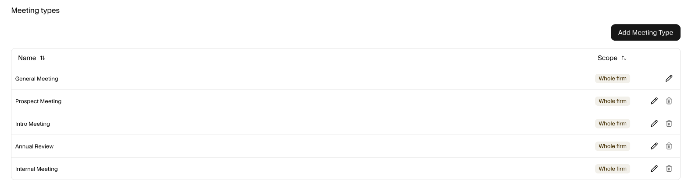
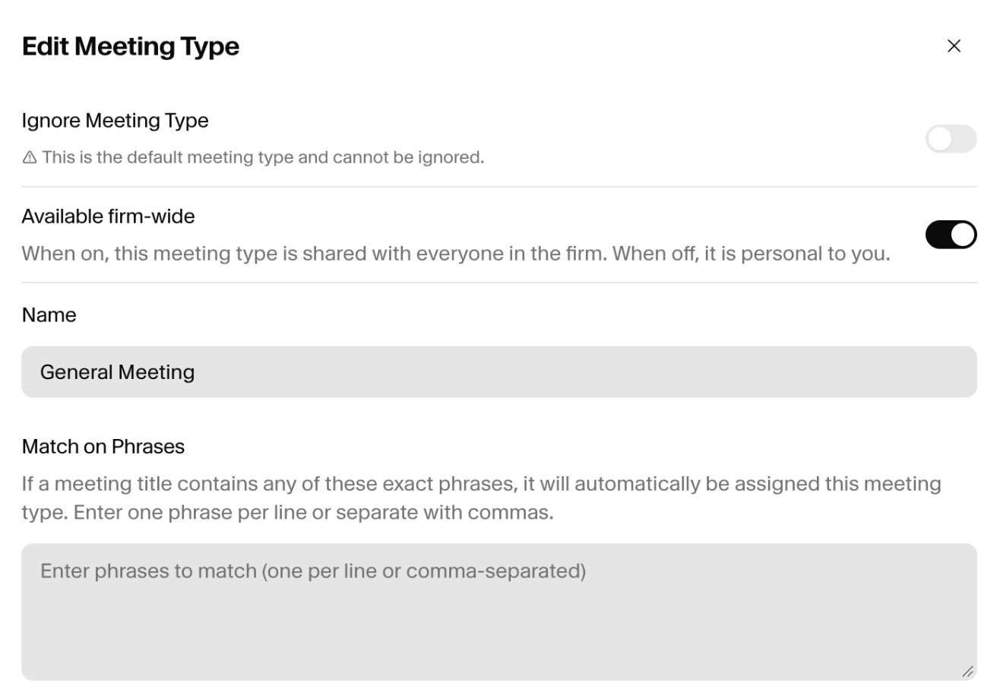

Meeting types tell Hazel what to prepare before a meeting and how to write it up afterward. Firm-wide meeting types live in **Settings → Recording**, and your personal ones in **Settings → Meetings**. Both pages list them in a **Meeting types** table at the bottom.

1. **Open the Meeting types table**
   - Select **Settings** at the bottom of the left navigation.
   - For a type everyone at your firm can use, open **Recording** under **Your firm**. Owners and Firm Admins can manage these.
   - For a type only you use, open **Meetings** under **You**.
2. **Add a New Meeting Type**
   - Select **Add Meeting Type**, or the pencil icon on an existing type to edit it.
   - Name the meeting type. **Available firm-wide** decides whether everyone at your firm can use it or only you.

   <Tip>
     If you don't want to start from scratch, add a meeting type with only a name and save it. It starts with the **General Meeting** prompts, ready for editing.
   </Tip>
3. **Customize Your Prompts**
   - Each meeting type can be tailored by editing its prompts. Hazel uses these prompts to generate structured outputs. You can set up prompts for:
     - **Agenda**: Define what should be prepared before the meeting. For example, highlight goals, discussion topics, or referral opportunities.
     - **Reminder Email**: Customize the tone and content of reminders sent to attendees before the meeting.
     - **Meeting Notes**: Guide Hazel on what information to capture during the meeting (e.g., goals, action items, key decisions).
     - **Follow-Up Email**: Personalize the post-meeting summary email that Hazel generates for clients or team members.
4. **Match on Phrases**

   - Under **Match on Phrases**, add words or phrases, one per line or separated by commas. If a meeting title contains one of them, Hazel automatically assigns this meeting type.
   - For example, adding "annual review" ensures that when those words appear in a calendar invite title, Hazel categorizes the meeting as an **Annual Review**.

## Ignore meetings automatically

To have Hazel skip recurring events such as a daily reminder, create or edit a meeting type, turn on **Ignore Meeting Type**, and add the event titles' phrases under **Match on Phrases**. The meeting type's name doesn't matter. Any calendar meeting whose title contains one of those phrases gets no notetaker and moves out of your main meetings list. The default **General Meeting** type can't be ignored.

To skip a single meeting instead, use **Ignore** on that meeting. That hides it only for you.

<Accordion title="Edit Prompts at Meeting Level">
  1. Head to any meeting that is 'Ready for Review'
  2. At the top of the meeting notes, click the button that says 'Customize Prompt'
  3. Edit the prompt
  4. Click 'Save and Regenerate'

  <Frame>
    
  </Frame>
</Accordion>

<Tip>
  Need help with prompting? Visit [Customizing Meeting Types](/guides/meeting-assistant/meeting-details/meeting-types/customizing-meeting-types) to get started, or the [Prompt Library](/resources/prompt-library/prompting-tips-and-tricks) for pre-built templates!
</Tip>
