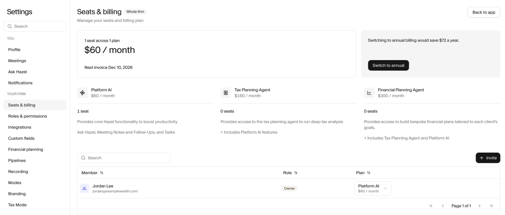
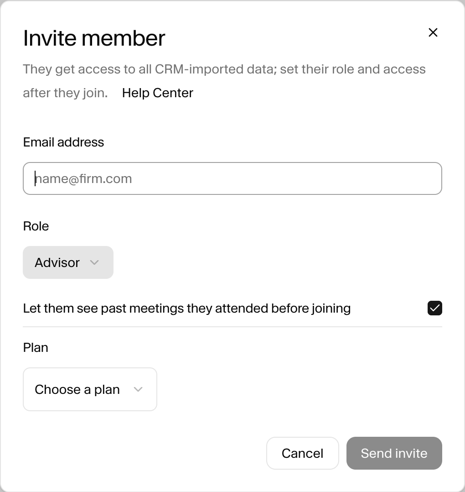

Hazel bills per seat. Manage your plan, seats, and payment details in **Settings → Seats & billing**, under **Your firm**. Owners and Firm Admins can open this page. For current rates, see the [pricing page](https://hazel.ai/pricing).

## Plans

Each person at your firm is assigned one plan:

| Plan | What it includes |
| :-- | :-- |
| **Platform AI** | Core Hazel: Ask Hazel, meeting notes and follow-ups, and tasks. |
| **Tax Planning Agent** | The tax planning agent for deep tax analysis, plus everything in Platform AI. |
| **Financial Planning Agent** | Financial plans tailored to each client, plus everything in the Tax Planning Agent and Platform AI. |

The top of the page shows how many seats you have, your monthly total, and your next invoice date.

## Add members

1. In **Settings → Seats & billing**, select **Invite** above the members table.
2. Enter their **Email address**.
3. Choose a **Role**: **Advisor** or **Owner**.
4. Choose a **Plan**.
5. Select **Send invite**.

Leave **Let them see past meetings they attended before joining** checked if the new member should see earlier meetings they were invited to.

Invited members get access to all CRM-imported data, so set their client access after they join. See [Managing teams](/guides/settings/members/managing-teams).

To change someone's plan, use the **Plan** dropdown on their row in the members table.

## Change plans mid-term

When you upgrade a seat in the middle of a billing period, you're charged today for the rest of the current period, and your renewal date stays the same. You see the exact amount before you confirm. If your firm is in a Financial Planning trial, the prorated charge is billed when the trial ends.

## Monthly or annual billing

On current plans, annual billing costs 10 percent less than paying monthly for 12 months. Firms on earlier pricing keep the rates they signed up with. The page shows how much your firm would save; select **Switch to annual** to change.

## Payment details, invoices, and cancelling

Scroll to the **Billing** section of **Settings → Seats & billing**. **Payment details** shows the card on file, and **Manage billing** opens the billing portal, where you can update your payment method, download past invoices, and manage or cancel your subscription.
