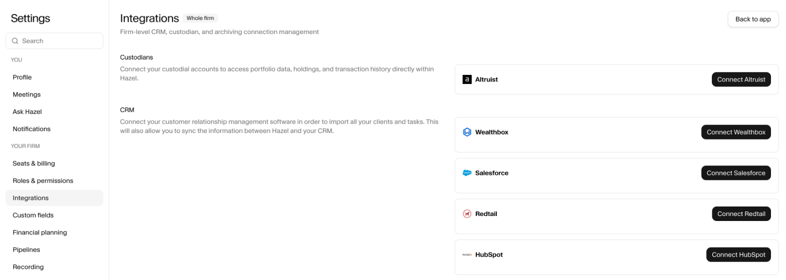

Hazel connects to your custodian, CRM, email, and calendar. Firm connections and personal connections live in different places in Settings.

## Custodian and CRM (Settings → Integrations)

Open **Settings → Integrations**, under **Your firm**, to connect:

- **Custodians**: Altruist. Each person connects their own Altruist login. See [Altruist](/guides/integrations/custodians/altruist).
- **CRM**: Wealthbox, Salesforce, Redtail, or HubSpot.
- **Import from a file**: bring in contacts from a spreadsheet if your CRM isn't supported.

### Manage a CRM connection

Once connected, a CRM card shows a menu with:

- **Trigger Sync** to refresh your CRM data now.
- **Choose contacts to sync** or **Edit sync selection** to pick which contacts come into Hazel.
- **Disconnect** to remove the connection.

## Email and calendar (Settings → Profile)

Email and calendar are personal, so they live in **Settings → Profile**, under **Email and Calendar**. Select **Connect Google** or **Connect Outlook**. Your HTML email signature is on the same page.

See [Google](/guides/integrations/calendar-and-emails/google) and [Outlook](/guides/integrations/calendar-and-emails/outlook) for what each connection gives Hazel access to.

## Compliance archiving (Settings → Meetings)

To archive meetings with Hadrius, open **Settings → Meetings** and connect it under **Archiving**.
