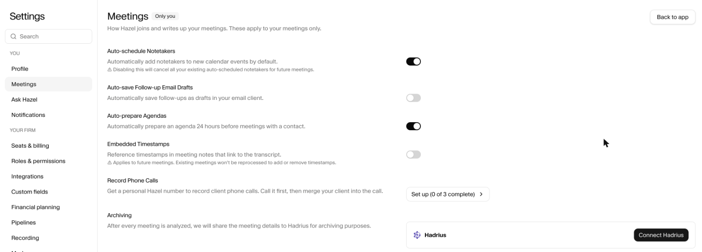
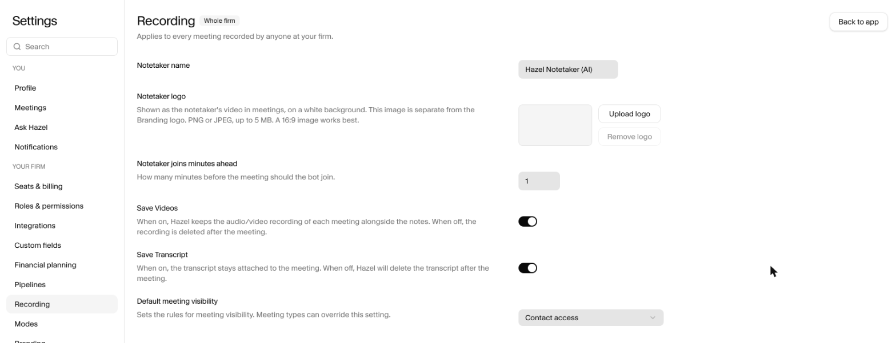
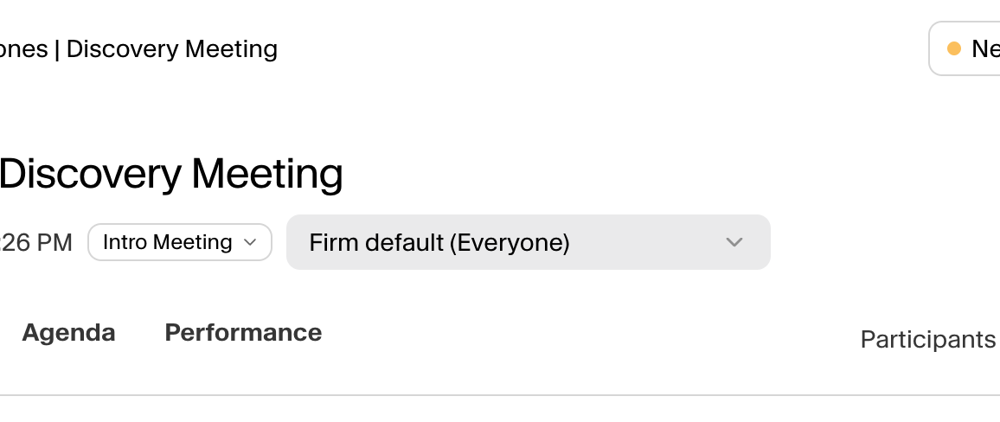

Meeting settings live in two places. **Settings → Meetings**, under **You**, holds the settings that apply only to your own meetings. **Settings → Recording**, under **Your firm**, holds the notetaker and storage defaults for everyone at your firm. To open Settings, select **Settings** at the bottom of the left navigation.

## Your meetings (Settings → Meetings)

| Setting | What it does |
| :-- | :-- |
| **Auto-schedule Notetakers** | Adds the notetaker to new calendar events by default. Turning it off cancels all your existing auto-scheduled notetakers for future meetings. |
| **Auto-save Follow-up Email Drafts** | Saves each meeting's follow-up email as a draft in your Gmail or Outlook drafts folder. |
| **Auto-prepare Agendas** | Prepares an agenda 24 hours before meetings with a contact. |
| **Embedded Timestamps** | Adds timestamps to meeting notes that link to the transcript. Applies to future meetings only. |
| **Record Phone Calls** | Sets up your personal Hazel number and your **Allowed callers**. See [Recording a meeting](/guides/meeting-assistant/recording-a-meeting). |
| **Archiving** | Connects Hadrius so each analyzed meeting is shared for compliance archiving. |

Your personal meeting types are listed at the bottom of this page. See [Adding meeting types](/guides/meeting-assistant/meeting-types/adding-meeting-types).

## Firm recording defaults (Settings → Recording)

Only firm Owners can change the notetaker and storage settings on this page. They apply to every meeting recorded by anyone at your firm.

| Setting | What it does |
| :-- | :-- |
| **Notetaker name** | The name the notetaker shows in meetings. The default is **Hazel Notetaker (AI)**. Changes apply to future meetings. |
| **Notetaker logo** | The image shown as the notetaker's video in meetings. PNG or JPEG, up to 5 MB; a 16:9 image works best. This is separate from your firm's Branding logo. |
| **Notetaker joins minutes ahead** | How many minutes before the scheduled start the notetaker joins. The default is 1 minute. |
| **Save Videos** | Keeps the audio and video recording with the notes. When off, the recording is deleted after the meeting. On by default. |
| **Save Transcript** | Keeps the transcript attached to the meeting. When off, the transcript is deleted after the meeting. On by default. |
| **Default meeting visibility** | Who at your firm can see new meetings. See [Meeting visibility](#meeting-visibility) below. |

<Note>
  Hazel adds "(AI)" to the notetaker's name on every platform, including Zoom, Google Meet and Microsoft Teams, and it can't be removed. If your name already includes "(AI)", Hazel doesn't add it again. On Teams, the name also ends with ". Recording".
</Note>

Firm-wide meeting types are listed at the bottom of the Recording page. Owners and Firm Admins can manage them.

## Meeting visibility

Meeting visibility controls **who at your firm can see a recorded meeting**: its transcript, notes, tasks, and summary. A firm Owner sets the firm-wide default in **Settings → Recording → Default meeting visibility**, and the meeting's owner can change it on any individual meeting.

### The four options

From most private to most open:

| Option | Who can see the meeting |
| :-- | :-- |
| **Private** | Only you (the meeting's owner). _Your firm's Owners can always see it, too._ |
| **Attendees only** | You and the teammates who attended the meeting. |
| **Contact access** | Anyone at your firm with access to a participant's household or contact. **(Default)** |
| **Everyone** | Every user at your firm. |

<Info>
  **Firm Owners always have access** to every meeting, regardless of the setting. So "Private" really means _only you and your firm's Owners_.
</Info>

### Set your firm's default

New meetings use the default automatically. Most firms leave it on **Contact access** so meetings are visible to the same teammates who already work with that client. You can change the default at any time; it applies to meetings going forward. Meeting types can override this setting.

### Change visibility for a single meeting

Open any meeting and use the **visibility selector** in the header to switch it to any of the four options, or set it back to your firm's default. The change takes effect immediately.

Only the meeting's **owner**, an **advisor who attended** the meeting, or a **firm Owner** can change a meeting's visibility. Everyone else sees the current setting as read-only.

<Tip>
  Under **Contact access**, if none of a meeting's attendees match a contact in Hazel, only you, any teammates who were invited to the meeting, and your firm's Owners can see it. To share it more widely, add a client as an attendee or set its visibility to **Everyone**.
</Tip>
