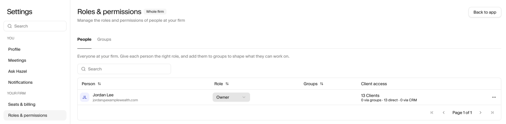

**Settings → Roles & permissions** is where you manage everyone in your firm: who's on the team, what each person can do, and, most importantly, **which clients each person can see**.

There are two separate ideas to keep in mind:

- **Roles** decide what someone can _do_ in Hazel (and whether they can manage firm settings). More on [Roles and Permissions](/guides/settings/members/roles-and-permissions).
- **Access** decides which **Households** and **Contacts** someone can _see_. Access is controlled per client, by sharing records with a person directly or with a **Group** they belong to.

<Info>
  **Who can manage this page?** Only **Owners** and **Firm Admins** see **Roles & permissions**. Some actions are limited to **Owners**: assigning the Owner role, changing or removing another Owner, the bulk access actions, and every change to groups (creating, renaming, deleting, adding or removing members, and setting a group's client access and automatic rules).
</Info>

## How Roles & permissions is organized

Open **Settings → Roles & permissions**, under **Your firm**. Across the top you'll find two tabs:

- **People**: everyone in your firm, with each person's role, groups, and client access
- **Groups**: reusable sets of people you can share clients with all at once

<Note>
  The **Groups** tab and the **Groups** and **Client access** parts of a person's page appear only when client access management is turned on for your firm. Without it, Roles & permissions shows just the list of people and their roles.
</Note>

The **People** list also shows pending invites (marked **Invited**) and requests to join your firm (marked **Access requested**, with a **Review** button).

## Roles

Every member has one role:

| Role | What it's for |
| :-- | :-- |
| **Owner** | Runs the firm in Hazel. Can see **every** household and contact, manage all settings, and manage the team. Owners are always Firm Admins. |
| **Advisor** | The standard seat. Works with the clients shared with them and uses Hazel's full feature set. |

**Firm Admin** is a separate permission you can give an Advisor so they can manage subscription and billing, firm members, firm branding, meeting types and planning settings, _without_ giving them access to any additional client data. Owners are always Firm Admins.

<Info>
  Giving someone access to settings (Firm Admin) and giving them access to clients are two different things. Making someone a Firm Admin never changes which clients they can see.
</Info>

## Managing members

### Invite a teammate

1. Go to **Settings → Seats & billing**.
2. Click **Invite** above the members table.
3. Enter their **Email address**.
4. Choose a **Role**: **Advisor** (default) or **Owner**, and a **Plan**.
5. Optionally check **Let them see past meetings they attended before joining**.
6. Click **Send invite**. If the plan you picked has no open seat, the button reads **Review seat purchase** instead, so you can review the added seat before it's billed.

The person appears in the list as **Invited** until they accept. See [Billing](/guides/settings/billing).

<Note>
  Invited members get access to all CRM-imported data (contacts, notes, tasks), so set their role and client access after they join. If your firm isn't on the current plans, **Invite** appears on the **People** tab of Roles & permissions instead.
</Note>

### Change a member's role or settings

You can change a role straight from the **Role** column on the **People** tab, then click **Save** in the bar at the bottom of the page.

For everything else:

1. On the **People** tab, click a person's row to open their page.
2. Under **Firm permissions**, change their **Role**, toggle **Tax Planning** (shown only when you manage billing on a legacy plan), or toggle **Firm Admin**. The rows below show which firm capabilities the person has (**Yes** or **No**).
3. Click **Review changes** in the bar at the bottom of the page, then click **Apply** in **Apply changes?**.

If the new role needs a paid seat and none is free, **Apply changes?** tells you a paid seat will be billed before you confirm. You can't turn Firm Admin off for an Owner or change it for yourself.

### Remove a member

To offboard someone, either:

- On the **People** tab, open the **⋯** menu on their row and click **Remove**, or
- Open their page and, under **Remove member**, click **Delete Member**.

Then confirm with **Remove**.

<Warning>
  Removing a member offboards them: they lose access to Hazel and to every client at your firm, and their seat is released. You can't remove yourself, and only an Owner can remove another Owner.
</Warning>

## Controlling who can see which clients

Access is set **per client**. Each time you share a household or contact, you choose a level:

| Level | What it allows |
| :-- | :-- |
| **Read** | Can view the client's details only. |
| **Write** | Can view and edit details. |
| **Manage** | Can edit details **and** manage access for other users. |

<Note>
  Some screens use plain-language names for the same levels: **Can view** (Read), **Can edit** (Write) and **Can manage** (Manage).
</Note>

There are three ways to share a client:

- **Directly with a person**: from the **Client access** section of their page, or from the client's own **Who has access** section.
- **With a Group**: share once with a Group, and everyone in it gets access (see [Groups](#groups)).
- **When you create the client**: choose who can see it right in the new-household or new-contact form.

<Info>
  **Owners always see everything.** You never need to share a client with an Owner.
</Info>

<Note>
  When you open the **Who has access** section from a household or contact's detail page, the controls only let you make changes if you have **Manage** on that record. If you can see the client but don't manage it, the section is read-only, so you can review who has access without risk of changing it.
</Note>

<Note>
  If your firm's client access is managed by your CRM, the access controls on these pages are read-only.
</Note>

### See and edit one member's access

Open **Settings → Roles & permissions → People** and click the person's row. Their page has two access sections:

- **Groups** lists the groups they belong to and what each group can reach. Owners can add them to a group with **Add to a group** and **Add**, or remove them from one with the **✕** on its row. These changes apply right away.
- **Client access** lists every client they can reach, with a summary of the total (via groups, direct and via CRM). Each row shows how they got access: **Granted directly**, **Synced from CRM**, or **via** a group's name. Use **Search clients** to find someone.

To change a direct share, pick a new level in the row's **Access** dropdown (**Can edit** or **Can view**), then click **Save** in the bar at the bottom of the page. To stop sharing, open the row's **⋯** menu and click **Remove access**; this applies right away.

<Info>
  Access that comes from a group, or from your CRM, can't be changed here. Edit the group's access instead (see [Share clients with a group](#share-clients-with-a-group)).
</Info>

### Share clients with one member

1. On the person's page, click **Add client** in the **Client access** section. A side panel opens.
2. Under **Permissions**, open **Households** or **Standalone contacts**. Each row summarizes what the member can reach today, for example _"42 total · 30 direct, 12 via groups"_.
3. Use the buttons above the list to focus by source: **All**, **Manual**, **CRM-synced**, or **Via group**. Each shows its count.
4. To add clients, click **Add households** / **Add contacts**, search, and check the clients to share (or **Select all shown**). Set the **Access level for new grants** (defaults to **Read**). Changing it after you've checked rows updates everything you've selected so far.
5. To change an existing share, use the level dropdown on a row: **Read**, **Write**, **Manage**, or **Remove access**.
6. Click **Review changes** in the bar at the bottom of the panel to see every staged change in one list, then click **Apply** (the button shows the number of changes, like **Apply 5 changes**).

<Info>
  Rows granted **via group** can't be edited from the member's panel. Rows marked **Managed by CRM sync** can't be changed either.
</Info>

<Tip>
  Nothing is saved as you click. Every change you make across Households, Standalone contacts, and Groups is staged into one set until you apply it. Clicking **Done** closes the panel and keeps your unsaved changes in the bar at the bottom of the page.
</Tip>

#### Bulk actions (Owners only)

Inside **Add households** or **Add contacts**, Owners see **Bulk actions** at the top. They're scoped to the resource type you're in (households _or_ standalone contacts), and like everything else they're staged until you apply.

| Action | What it does |
| :-- | :-- |
| **Grant all access** | Stages a grant for **every** household (or contact) in the firm at the current **Access level for new grants**. |
| **Copy access from…** | Pick another member under **Copy from** and click **Stage copy**. Stages grants for everything they can access of this resource type. The member's existing access is kept. |
| **Revoke all access** | Stages removal of every direct grant the member has for this resource type. Group-granted access isn't touched. |

### Set access when creating a client

When you create a household or contact, use the **Who can access this household?** / **Who can access this contact?** section to add the people and groups who should see it. Owners are always included automatically. You can fine-tune levels after it's created.

## Groups

A **Group** is a named set of people. Share a household or contact with a Group, and **everyone in that Group** can see it, so you set up access once instead of person by person. Groups are perfect for service teams, pods, or "everyone who works with retirement clients."

The **Groups** tab lists each group with its rules (or **No rules yet**), how many people are in it, and how many households and contacts it can reach. Click a group to open its page.

<Note>
  Only **Owners** can create, change or delete groups.
</Note>

### Create a group

1. Go to **Settings → Roles & permissions → Groups**.
2. Click **New group**.
3. Enter a **Group name**.
4. Optionally, under **Add members**, search by member name or email and pick the people to add.
5. Optionally, under **Rules**, choose **Clients owned by** (an advisor, or **Anyone**), add tags under **Clients tagged with**, and choose what **This group** gets: **Can edit** (default) or **Can view**. If you set an owner or a tag, the group gets a rule for both households and contacts.
6. Click **Create group**.

### Add people to a group

1. Open the group's page from the **Groups** tab.
2. Under **Members**, search by member name or email, pick the people to add, and click **Add**.
3. To remove someone, click the **✕** on their row.

These changes apply right away. Everyone you add immediately gains access to whatever the Group can see. You can also add someone to a group from their own page (see [See and edit one member's access](#see-and-edit-one-members-access)).

### Share clients with a group

On the group's page, the **Rules** section lists the group's rules. Click **Manage household access** or **Manage contact access** to open the **Household access** or **Contact access** window. It has three tabs that share a single set of pending changes:

- **Add households** / **Add contacts**: pick clients by hand.
- **Automatic rules**: set rules that share matching clients (and future ones) for you. See [Automatic rules](#automatic-rules).
- **Has access**: review who the group can currently see, with a preview of what changes after you apply.

The **Has access** tab shows a count. When you have pending changes, it previews the result, for example _"42 → 47"_ means the group reaches 42 clients today and will reach 47 after you apply.

1. On the **Add households** / **Add contacts** tab, search and check the clients to share.
2. Optionally switch to **Automatic rules** to add a rule, or **Has access** to preview the result. The footer shows a running tally of pending changes.
3. Click **Review changes** in the bar at the bottom of the window, then click **Apply** (the button shows the number of changes). Group members gain or lose access as soon as you apply.

<Note>
  In a Group's **Contact access** window you can only add **standalone contacts**. Contacts who belong to a household automatically follow that household's access.
</Note>

### Rename or delete a group

Use the **⋯** menu on a group in the **Groups** tab:

- **Rename** opens **Rename group**. Enter the new name and click **Save**. You can also change the **Group name** on the group's page and click **Save** in the bar at the bottom.
- **Delete** opens **Delete group?**. Click **Delete group** to confirm.

<Warning>
  Deleting a group revokes the access its members get **through that group**. People keep any access granted to them directly or through another group.
</Warning>

## Automatic rules

Instead of adding clients to a Group one by one, you can set up an **automatic rule** that shares matching clients with the Group for you, both clients that match today **and** any that match in the future.

A rule matches on:

- **Owner**: the advisor a client is assigned to, and/or
- **Tag**: clients carrying the tags you choose.
- **Advisor role** (households only): an advisor role imported from your CRM, paired with the advisor who holds it.

### Create a rule

1. Open a group's **Household access** or **Contact access** window.
2. Go to the **Automatic rules** tab and click **Create rule**.
3. Under **Where**, add conditions: choose an **Owner** and/or one or more **Tags**. For households, you can also choose an **Advisor role** and then the advisor.
4. Under **Grant**, choose **Can edit** (default) or **Can view**.
5. Check the preview, for example _"24 contacts match today · future contacts that match will be added automatically."_
5. Click **Add rule**. The rule appears in the list with a **Pending** badge until you apply.
6. Click **Review changes**, then **Apply**.

A rule needs at least one condition before you can add it.

<Tip>
  You can edit or delete a rule from the **Automatic rules** tab. The pencil icon reopens the rule so you can change it and click **Save rule**; the trash icon stages a deletion and shows how many clients would lose access.
</Tip>

**How rules combine:**

- Within a single rule, a client must match **every** condition (for example, owned by _Jane_ **and** tagged _Tax_).
- Across rules, a client that matches **any** rule gets access.

### See who a group can reach

Open the **Has access** tab in either access window to review everyone the Group can currently see, split into **Added manually** and one **Via rule:** section per rule (headed by the rule's description). It's a quick way to audit access.

When you have pending changes, the tab previews the result: rows you've added show **Will add**, rows you've removed show **Will remove**, and each pending rule shows how many clients will gain access, with **View list** to see them. Use the **✕** on a manual row to stage a removal. Rows that come from a rule can't be removed one by one; edit or delete the rule instead.

<Warning>
  A few things to know about rules:

  - If you remove a client by hand but a rule still matches them, they **keep** access through the rule. To stop sharing, edit or delete the rule.
  - Deleting a rule removes the access that rule granted.
</Warning>

## Tips

- **Start with Groups.** For anything more than one or two people, share with a Group instead of individuals. It's far easier to maintain.
- **Use rules for "always" sharing.** If a whole category of clients should always be visible to a team (by owner or tag), a rule keeps it current automatically as clients are added.
- **Remember the two axes.** Role = what someone can do; access = which clients they can see. Making someone a Firm Admin doesn't reveal any new clients.
- **Owners see everything.** You don't need to share clients with them.

## Related

- [Roles and Permissions](/guides/settings/members/roles-and-permissions): a closer look at what each role can do
- [Owner / Admin Capabilities](/guides/settings/members/owner-capabilties): managing the team and firm settings
