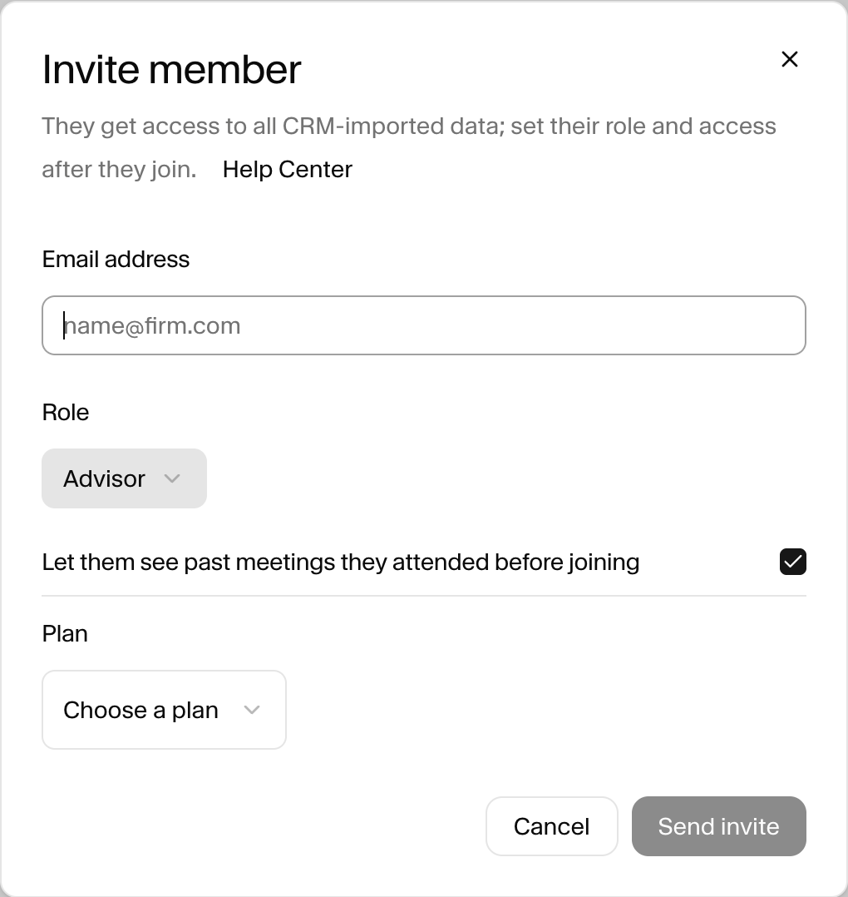

Owners and Firm Admins bring teammates into Hazel, set their roles, and decide which clients they can see.

<Warning>
  Hazel does not import existing roles and permissions from your CRM. Invited members get access to all CRM-imported data, so review their client access after they join.
</Warning>

### Inviting team members

1. Go to **Settings → Seats & billing**.
2. Select **Invite** above the members table.
3. Enter the team member's email address.
4. Choose a **Role** (**Advisor** or **Owner**) and a **Plan**.
5. Select **Send invite**.

Your teammate receives an email with instructions to join Hazel. Once they accept, they have access according to the role and plan you selected.

### Editing member roles

1. Go to **Settings → Roles & permissions**.
2. On the **People** tab, find the team member.
3. Change their **Role** from the dropdown on their row, or open their page to turn **Firm Admin** or **Tax Planning** on or off under **Firm permissions**.

Changes take effect immediately. Only an Owner can make someone an Owner.

### Controlling who sees which clients

Client access is set per household or contact, either directly for a person or through a group. See [Managing teams](/guides/settings/members/managing-teams) for the steps.
