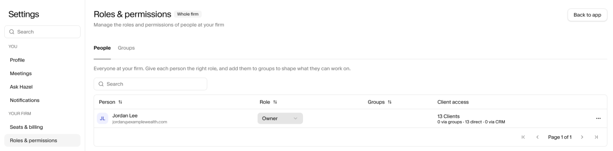

Every member of your firm has a role: **Owner** or **Advisor**. On top of the role, an Owner can give an Advisor the **Firm Admin** permission. The role and Firm Admin decide what someone can manage. Which clients someone can see is controlled separately, per household or contact, by sharing. Owners see every record; everyone else sees only the records shared with them.

Manage roles in **Settings → Roles & permissions**, under **Your firm**. Owners and Firm Admins can open this page.

## Role comparison

|  | Owner | Advisor with Firm Admin | Advisor |
| :-- | :-- | :-- | :-- |
| Sees every household, contact and meeting | ✅ Yes | ❌ Only what's shared with them | ❌ Only what's shared with them |
| Manages members, billing, firm branding, meeting types and financial planning settings | ✅ Yes | ✅ Yes | ❌ No |
| Changes firm recording defaults (notetaker name and logo, saving, default meeting visibility) | ✅ Yes | ❌ No | ❌ No |
| Records meetings, uses Ask Hazel, syncs notes and tasks to the CRM | ✅ Yes | ✅ Yes | ✅ Yes |

## Owner

Owners run the firm in Hazel, with <u>full visibility</u>. They can see every household, contact and meeting, manage every firm setting, and are always Firm Admins. Only an Owner can transfer ownership.

<Info>
  Hazel does not import roles and permissions from your CRM. After you connect it, decide who should see which clients. See [Managing teams](/guides/settings/members/managing-teams).
</Info>

## Advisor

The **Advisor** seat gives full access to Hazel's productivity tools: record, prepare and debrief meetings, use Ask Hazel, send client emails, and sync notes and tasks to the CRM.

An Advisor can review and sync notes and tasks for any meeting they can see, including another advisor's. Which meetings that is depends on your firm's [meeting visibility](/guides/settings/meeting-settings#meeting-visibility) setting and the clients shared with them, so it doesn't require firm-wide access. Syncing uses your firm's CRM connection, so your CRM's own permissions still apply.

## Firm Admin

**Firm Admin** is a permission, not a separate role. It lets an Advisor manage members, billing, firm branding, meeting types, and financial planning settings. It does not give them access to any more client data. Owners turn it on from the person's page in **Settings → Roles & permissions**.

## Assistant seats

Assistant seats are no longer sold, and new teammates are invited as an Advisor or an Owner. If your firm already has Assistant seats, those teammates keep them, and an unused Assistant seat can be reassigned from a member's settings.

For a support or operations teammate, invite them as an Advisor and share only the clients they work on. Add Firm Admin if they also need to manage the team or billing.
